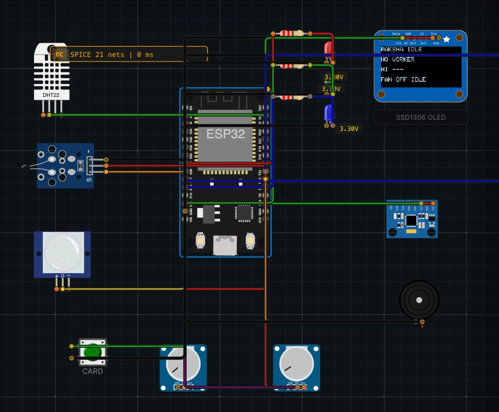
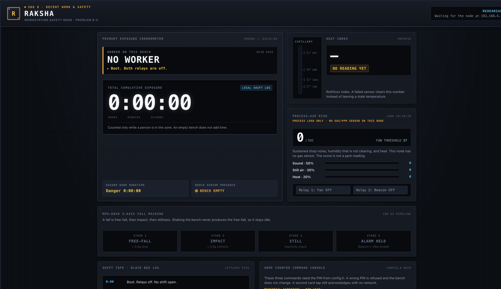
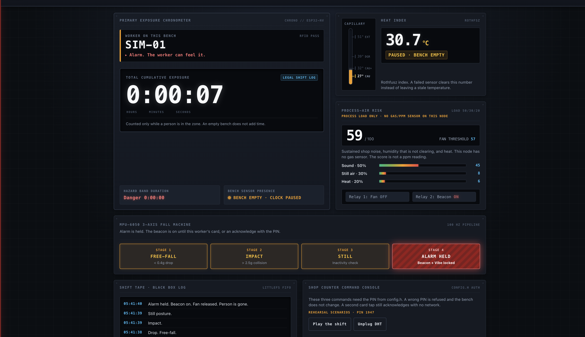

# RAKSHA

A bench safety node for informal workshops. It watches heat stress, process-air risk, and falls, warns the worker on the spot, and keeps an exposure record that only counts while a person is actually at the bench.

Built for **SDG 8 — Decent Work and Economic Growth**, problem **8-A**: a heat and air-safety monitor for informal workers.

The full write-up, with formulas, pins, faults, and the same figures, is in [docs/REPORT.md](docs/REPORT.md). A printable copy is [docs/REPORT.pdf](docs/REPORT.pdf).

## The bench, running

Boot on the Logicraft canvas. Relays are off, no worker is signed on, and the OLED does not invent a temperature.



## The dashboard

The page is one instrument for one bench. The largest number is the exposure clock. It advances only while someone is in the zone.



After a scripted shift: worker SIM-01, heat index 30.7 °C, process risk 59, beacon held after a fall, clock paused because the bench is empty again.



Open the page from this repo with any static server, or open `dashboard/index.html`. Press **Play the shift**. The rehearsal PIN is `1947`. On the real node the same page is served at `http://192.168.4.1/` and the PIN is the one in `config.h`.

## Problem

People in brick kilns, tailoring units, welding shops, and small construction sites work in heat, dust, and fumes with no instrument on the bench. A bad hour is invisible until someone is already hurt. Employers have no record of how long a named worker was in those conditions.

RAKSHA is the instrument for that bench. It is a workstation node, not a phone app the worker has to remember to open.

## What it does

- Signs a known worker onto the shift with an RFID card. An unknown card cannot open a shift. A second tap of the same card acknowledges an alarm.
- Computes a Rothfusz heat index from the DHT22 and places it on a five-step band: below 27 °C, caution, extreme caution, danger, extreme.
- Scores process air from sustained shop noise, humidity that is not clearing, and heat. The kit has no gas sensor. The score is not a ppm reading.
- Counts exposure seconds only while PIR or IR sees a person. An empty bench does not add hours. Danger and extreme bands also count danger seconds.
- Detects a fall as free-fall, then impact, then a still posture. Shaking the bench never produces the free-fall dip, so kiln vibration stays idle.
- Warns on the body with a vibration motor and an RGB LED. A fan relay closes on danger heat or on process risk while a person is present. A beacon relay closes on a latched fall.
- Drops both relays at boot and on a sensor fault. A failed DHT clears the temperature. The node does not keep showing a stale “safe” number.
- Writes a CSV row every 15 seconds and on every edge, and serves a local dashboard that still works when the workshop router is down.

## Tech stack

| Layer | What it is |
|---|---|
| Controller | ESP32 DevKit V1, Arduino C++ on the ESP32 core |
| Climate | DHT22 on GPIO 4. NTC divider, 10 kΩ, β 3950, on GPIO 36. Barometer temperature is a third vote on the bench; pressure is logged only |
| Motion | MPU6050 at ±2 g, +Z up, read every 10 ms. No DMP, no gyro fusion |
| Presence | PIR through a 74HC14 on GPIO 34. IR proximity on GPIO 35 |
| Process air | KY-037 analog envelope on GPIO 32. Threshold potentiometer on GPIO 33 |
| Identity | RC522 RFID over SPI |
| Worker interface | SSD1306 OLED at 0x3C. RGB LED. Vibration motor through a 2N2222A, with a 1N4007 across the motor |
| Loads | 2-channel relay, active-low, fan on GPIO 17 and beacon on GPIO 26 |
| Power | 12 V adapter, HW-411 buck measured at 5.0 V before the ESP32 is connected. 5 V feeds VIN, relay VCC, and the motor. The 74HC14 runs at 3.3 V |
| Record | LittleFS, `/shift.csv` |
| Network | STA for 10 s, then access point `RAKSHA` at `192.168.4.1` |
| Dashboard | One HTML file, CSS and script inline, no external assets. Polls `GET /api/state` every 2 s |
| Simulation | [Logicraft Studios](https://logicraftstudios.tech/editor/) Velxio editor. Project file `simulation/raksha-logicraft.zip` |

Left unwired on purpose: 4×4 keypad, I2C LCD, the spare 1-channel relay, 2N3906, IRF9540. The OLED is the only display. A second card tap is the offline acknowledge.

## Architecture


```text
POWER → BOOT → SENSE → ESTIMATE → DECIDE → ACT → RECORD → SERVE
```

The 10 ms path reads the MPU6050 and steps the fall machine. It does not read the DHT22, write flash, or serve HTTP. Environment samples run every 2 seconds. The stage contracts, structs, and pin map are in [docs/pipeline.md](docs/pipeline.md).

## Results

These lines are from one `RUN` on the simulator. The threshold is held at 57. The same formulas are in the sketch.

| Step | What happened |
|---|---|
| Boot | `BOOT relays=OFF`. OLED up. MPU up. No worker |
| Card, 30 °C / 55% RH, sound 0.10, person present | `SHIFT worker=SIM-01`. Heat index **31.9 °C**, band **CAUTION**, risk **13.1**, fan off |
| Short clap, sound 0.12, 28 °C / 70% RH | Heat index **30.7 °C**, risk **19.6**, fan stays off |
| Sustained noise, sound 0.90 | Risk **58.6**, air alert on, **fan on**, band still CAUTION |
| Shake for 2.5 s, magnitude stays above 1 g | Fall stays **IDLE** |
| Drop, then a still tilted posture, person gone | `FREEFALL` → `IMPACT` → `CONFIRM` → `ALARM`. Beacon on. Fan releases |
| Second card | `ACK`. Fall returns to IDLE. Beacon off |
| DHT removed | `FAULT DHT relays=OFF`. Heat index cleared |

## Dashboard, and how it works

Five panels, in the order a person at the bench reads them.

1. **Exposure chronometer.** Worker id, shift mode, and the running exposure time. Danger time is a second, smaller clock. Presence is a lamp: in the zone, or bench empty and the clock paused.
2. **Heat capillary.** Marks at 27, 32, 39, and 51 °C. The number is the Rothfusz index. If the DHT fails, the number is cleared. If the index is still valid but nobody is present, the band is marked paused.
3. **Process-air risk.** Score against the threshold, split into sound (50%), still air (30%), and heat (20%). Fan and beacon are shown as the two relay loads.
4. **Fall machine.** Four stages: free-fall, impact, still, alarm held. The held stage stays on until acknowledge.
5. **Shift tape and counter.** The tape is the recent edge log. The counter sends three commands. Each one needs a PIN. A wrong PIN returns a refusal and changes nothing.

| Call | Body | Effect |
|---|---|---|
| `GET /api/state` | none | Live decision. No PIN |
| `POST /api/ack` | `{ "pin" }` | Clears a held fall. Wrong PIN is HTTP 401 |
| `POST /api/fan` | `{ "pin", "on" }` | Fan relay, refused while a fault is holding the relays off |
| `POST /api/threshold` | `{ "pin", "value" }` | Risk threshold, clamped to 30–90 |

Until the ESP32 is on the network, the page runs a rehearsal of the same scenario. When `GET /api/state` answers, the rehearsal controls hide and the page polls every 2 seconds.

## Simulation

1. Open [logicraftstudios.tech/editor](https://logicraftstudios.tech/editor/).
2. If a new-project panel is up, cancel it.
3. **File → Open project…** and choose `simulation/raksha-logicraft.zip`.
4. Install, if they are missing: DHT sensor library for ESPx, Adafruit GFX Library, Adafruit SSD1306, Adafruit BusIO.
5. Press the green run control. In the serial box, type `RUN` and send it with a newline.

The canvas uses stand-ins where the editor has no matching part. The green CARD button is the RFID tap. The left potentiometer is the KY-037 envelope. The buzzer is the vibration motor. There is no barometer on the canvas, so the heat vote is DHT22 against the NTC.

## Repository

```text
dashboard/index.html     the page, also the file the node serves at /
docs/REPORT.md           full project report
docs/REPORT.pdf          same report, printable
docs/pipeline.md         stage contracts, formulas, pins
docs/runbook.md          build order, demo, hidden scenarios
docs/figures/            simulation, dashboard, architecture
simulation/              Logicraft project (diagram, sketch, zip)
```
